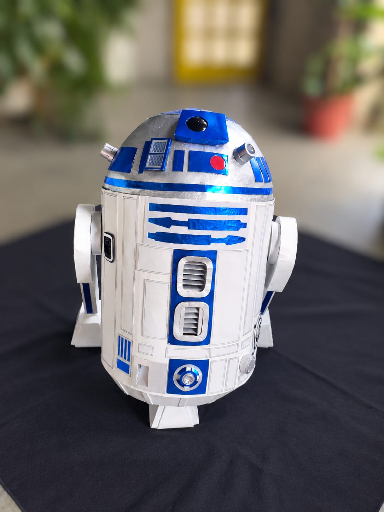
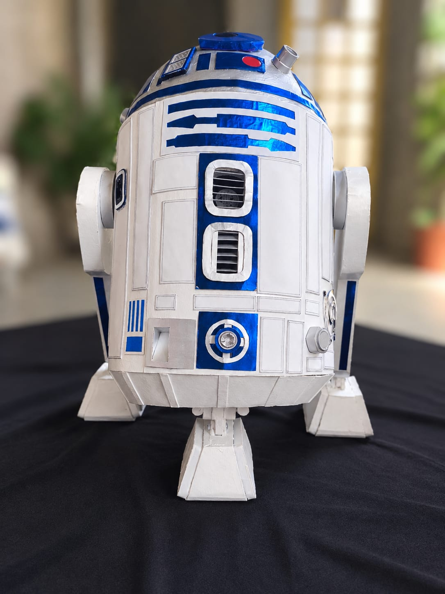
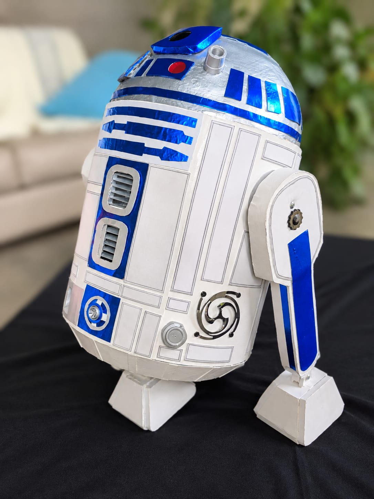
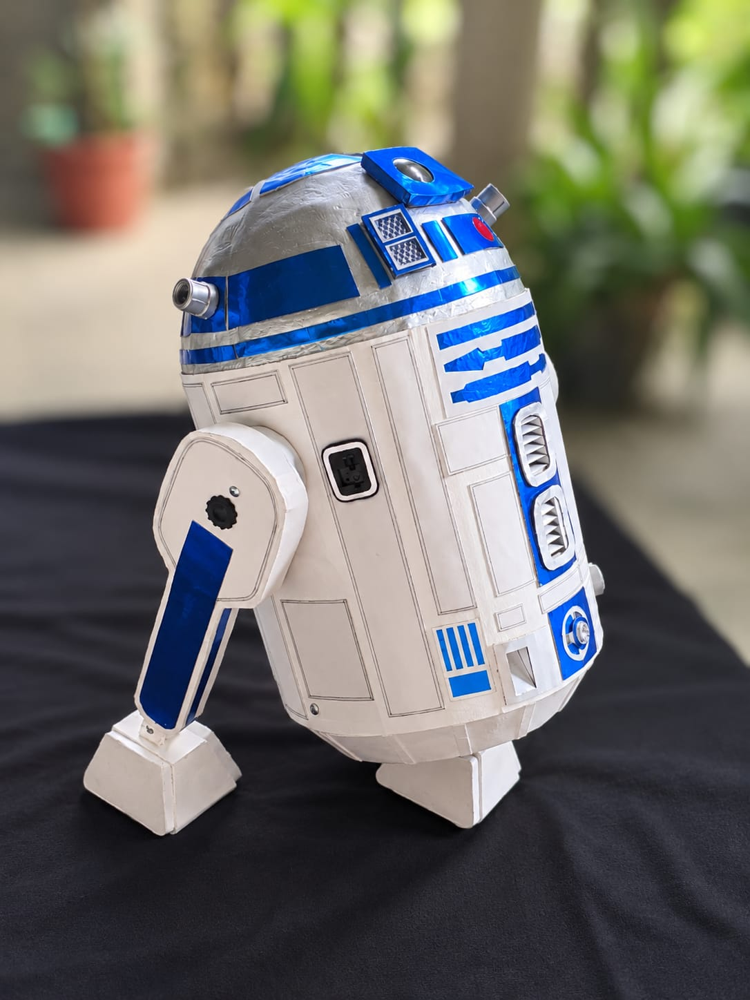
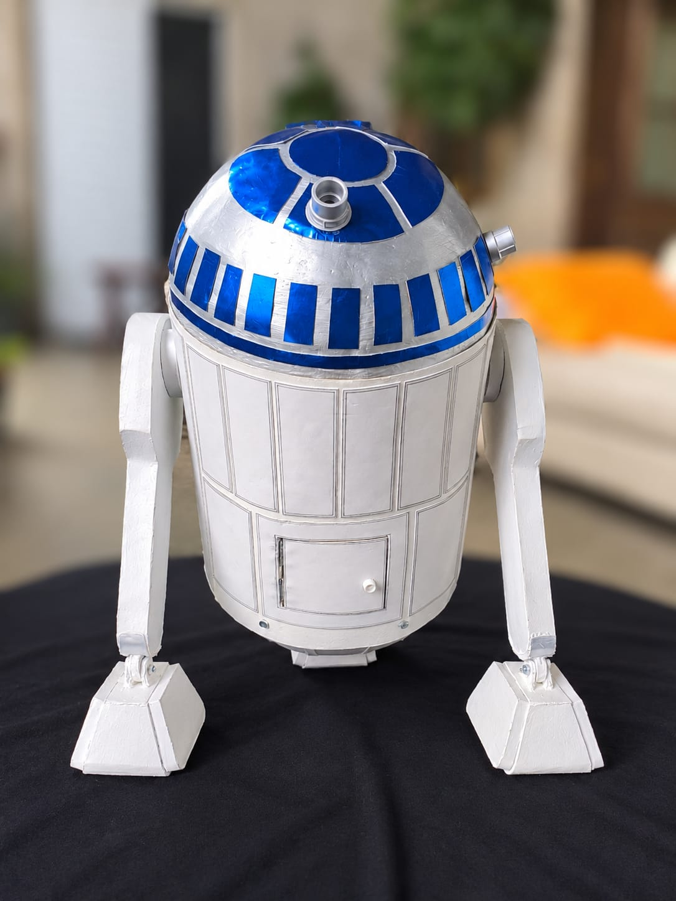
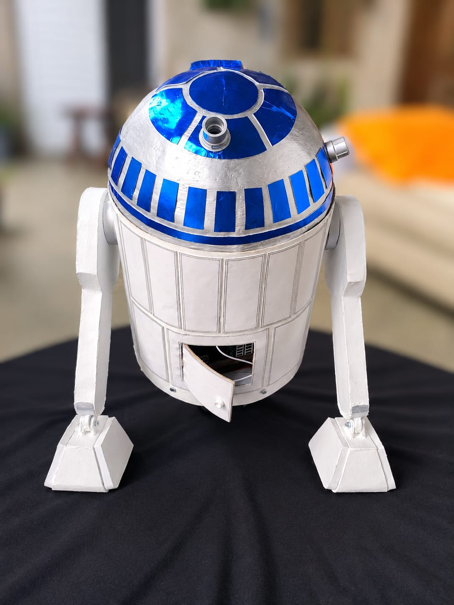
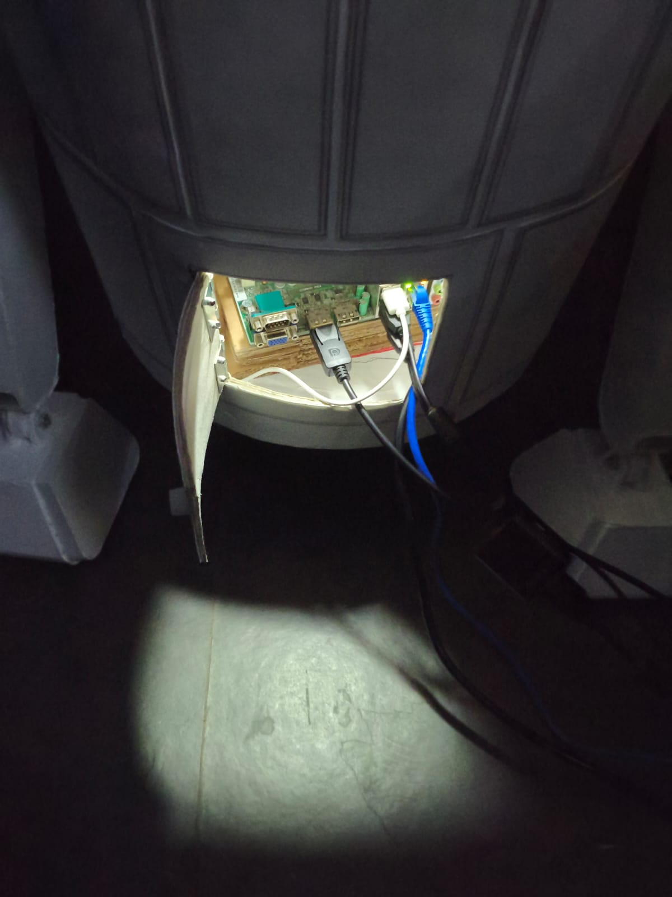
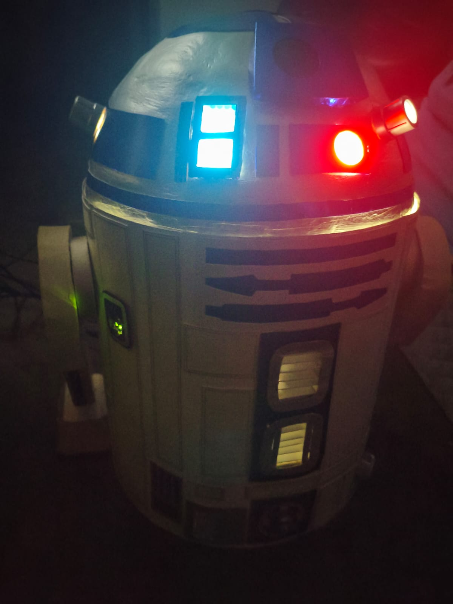
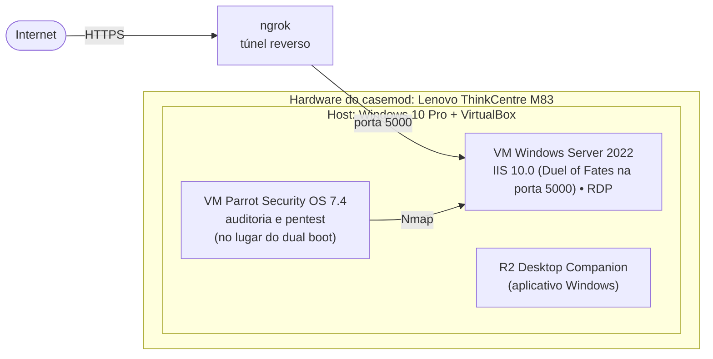

  

<h1 align="center">R2-D2 Casemod</h1>

  <strong>R2-D2: Droid Interativo</strong> 
  Um computador completo, construído dentro de um R2-D2 de papelão, que hospeda e executa os projetos de software da própria equipe.

  
  
  
   
  
  
  
  
   
  
  

---

## Sobre o projeto

O **R2-D2 Casemod** é um projeto acadêmico do **Centro Universitário UniFECAF (Campus Sede)**, apresentado na **EXPOTEC 2026**, em Taboão da Serra (SP). Ele consiste em um **computador personalizado** montado dentro do torso de um droide R2-D2 (franquia *Star Wars*) de **80 cm de altura**, feito de papelão reciclado e papel Paraná.

O projeto reúne várias áreas:

- **Arquitetura e construção** do casemod, com pernas articuladas e acessos para cabos e botão *Power*.
- **Montagem e integração do hardware** ao casemod.
- **Sistemas operacionais**, particionamento e configuração do ambiente.
- **Virtualização e administração de servidores**, com Windows Server 2022 e IIS.
- **Cibersegurança**, com auditoria de portas e hardening.
- **Aplicações próprias**, hospedadas e executadas no computador: o jogo *Duel of Fates* e o *R2 Desktop Companion*.

> **Aviso legal.** Projeto acadêmico, sem fins lucrativos. R2-D2 e *Star Wars* pertencem à Lucasfilm Ltd. e à Walt Disney Company; este projeto não é oficial e não tem afiliação com elas.

## Galeria

<table>
  <tr>
    <td align="center"> Vista frontal em três quartos</td>
    <td align="center"> Vista frontal</td>
    <td align="center"> Lateral, com detalhe em espiral no torso</td>
    <td align="center"> Lateral, com a perna articulada e o botão <em>Power</em></td>
  </tr>
  <tr>
    <td align="center"> Traseira, porta de acesso fechada</td>
    <td align="center"> Traseira, porta de acesso aberta</td>
    <td align="center"> Acesso traseiro, com cabos ligados</td>
    <td align="center"> Casemod iluminado no escuro</td>
  </tr>
</table>

O processo de construção está documentado com fotografias em [docs/arquitetura.md](docs/arquitetura.md).

## Arquitetura e infraestrutura

O casemod tem **cabeça** (iluminação interna e caixas de som) e **torso** (computador em três níveis), mais pernas articuladas e pés.

| Item | Valor |
| --- | --- |
| Altura total | 80 cm (dos pés ao topo da cúpula) |
| Circunferência total | 144 cm (pernas e torso) |
| Torso | 41 cm de altura e 126 cm de circunferência superior |
| Cúpula | 62 cm de arco e 120 cm de circunferência da base |
| Material | Papelão reciclado e papel Paraná natural (isolante elétrico) |

Detalhes, etapas e desafios em [docs/arquitetura.md](docs/arquitetura.md).

*Esquema simplificado. O ngrok expõe a porta 5000, a do site do Duel of Fates no IIS ([detalhes](docs/software-e-infraestrutura.md#9-ngrok-e-fluxo-de-acesso-externo)).*

## Hardware

| Componente | Especificação |
| --- | --- |
| Plataforma | Lenovo ThinkCentre M83 (modelo 10AJ0011BP), placa-mãe Lenovo SHARKBAY |
| Processador | Intel® Core™ i7-4770 @ 3,40 GHz (4 núcleos, 8 threads) |
| Memória | 16 GB DDR3 @ 1333 MHz (4 de 4 slots, dual channel) |
| Gráficos | Intel® HD Graphics 4600 (integrada) |
| Armazenamento | SSD Western Digital WD Green 240 GB SATA III |
| Rede | Intel® Ethernet Connection I217-LM (Gigabit) |
| Fonte | AcBel PCB020, 240 W, 80 PLUS Bronze |
| BIOS | UEFI, Secure Boot desativado |

A iluminação interna e as caixas de som, na cabeça, são ligadas ao computador por USB (não há microcontrolador). Detalhes e integração ao casemod em [docs/hardware.md](docs/hardware.md).

## Sistemas operacionais e virtualização

| Ambiente | Sistema | Função |
| --- | --- | --- |
| **Host** | Windows 10 Pro 22H2 (build 19045) | Sistema principal; executa o VirtualBox; usa ProtonVPN |
| **VM `wswerv`** | Windows Server 2022 | Hospeda a aplicação web (IIS 10.0); acesso externo via ngrok (HTTPS); administração remota por RDP |
| **VM `Parrot_Cyber`** | Parrot Security OS 7.4 | Estação de segurança: auditoria de portas e pentest; roda em VM, ao lado do Windows, no lugar do dual boot planejado |

O SSD de 240 GB é dividido em **C:** (97 GB, Windows 10), **D:** (78 GB, máquinas virtuais em discos `.vdi`), partições de sistema e cerca de 44 GB não alocados. As VMs usam rede em modo Bridge.

Na segurança, a equipe aplicou DNS anti-malware (Cloudflare 1.1.1.2 e 1.0.0.2), limite de requisições por IP no ngrok (Traffic Policy), Windows Defender, Firejail no Parrot, ProtonVPN, atualização dos sistemas e senhas fortes. Uma varredura **Nmap** a partir do Parrot revelou portas desnecessárias no servidor; uma **regra de firewall** bloqueou as portas 5357 e 5985, e o RDP foi habilitado apenas na rede local, com NLA. Uma 2.ª varredura confirmou que ficaram expostos apenas o IIS (80) e o RDP (3389).

Detalhes em [docs/software-e-infraestrutura.md](docs/software-e-infraestrutura.md) e [docs/seguranca.md](docs/seguranca.md).

> **Nota:** o dual boot chegou a ser planejado, mas, por uma mudança de última hora, o Linux (Parrot) roda em máquina virtual. Assim, o Linux e o Windows funcionam ao mesmo tempo, o que é necessário para auditar a rede.

## Projetos relacionados

Os projetos de software têm repositórios independentes, com código e documentação próprios. Aqui, o foco é a relação deles com o casemod.

### R2 Desktop Companion

Mascote desktop para **Windows 10/11 (x64)** em **Python e PySide6**: um droide com janela transparente, animações e peças articuladas, com sete personagens, ferramentas (relógio, temporizador, tarefas e notas) e catálogo de minigames. Funciona **offline**, sem IA, backend ou telemetria. É independente do casemod.

**Repositório:** [nicolasgrotto/r2-desktop-companion](https://github.com/nicolasgrotto/r2-desktop-companion)

### Duel of Fates

Jogo de duelo de lâminas de energia em visão lateral, feito em **Godot 4.7 (GDScript)**, com 11 personagens, 10 arenas e vários modos, em português e inglês. A exportação Web é estática, e o jogo foi **hospedado na VM Windows Server 2022 com IIS** (site na porta 5000), com acesso externo via **ngrok**. O Companion abre o jogo pelo menu Ferramentas → Minigames.

**Repositório:** [nicolasgrotto/duel-of-fates](https://github.com/nicolasgrotto/duel-of-fates) · **Jogar no navegador:** [nicolasgrotto.github.io/duel-of-fates](https://nicolasgrotto.github.io/duel-of-fates/)

## Equipe e matriz RACI resumida

| Integrante | Responsabilidades principais |
| --- | --- |
| **Heitor Resende** | Arquitetura do casemod, planejamento estrutural, construção física, máquinas virtuais e Windows Server 2022 |
| **Gabriel Cardoso** | Montagem e integração do hardware, sistemas operacionais, particionamento e ambiente Linux, cibersegurança |
| **Nicolas Egea** | Montagem e integração do hardware, sistemas operacionais, particionamento e ambiente Linux, cibersegurança |
| **Nicolas Oliveira** | Companion, Duel of Fates, hospedagem com IIS e acesso externo via ngrok |

Todos participaram do projeto. A matriz abaixo resume a matriz RACI: **R** executa, **A** responde pela entrega e **C** participa e é consultado.

| Área | Heitor | Gabriel | Nicolas Egea | Nicolas Oliveira |
| --- | :---: | :---: | :---: | :---: |
| Arquitetura e construção do casemod | R, A, C | C | C | C |
| Montagem, integração do hardware e testes de validação | R, A, C | R, A, C | R, A, C | R, A, C |
| Sistemas operacionais e particionamento | C | R, A, C | R, A, C | C |
| Cibersegurança | C | R, A, C | R, A, C | C |
| Máquinas virtuais e Windows Server 2022 | R, A, C | C | C | C |
| Hospedagem no IIS e acesso externo via ngrok | C | C | C | R, A, C |
| Desenvolvimento do Companion e do Duel of Fates | C | C | C | R, A, C |

Matriz completa, com 11 atividades, em [docs/equipe.md](docs/equipe.md).

## Cronograma

| Atividade | Período |
| --- | --- |
| Arquitetura e construção do casemod | Setembro até o início de novembro de 2026 |
| Desenvolvimento do Duel of Fates | Meados de outubro até 15 de novembro de 2026 |
| Montagem do computador e configuração dos softwares | Final de outubro até 14 de novembro de 2026 |
| Brainstorming do Companion | Início de novembro de 2026 |
| Desenvolvimento do Companion | Aproximadamente de 8 a 15 de novembro de 2026 |
| Integração e finalização | Novembro de 2026 |

Evolução completa em [docs/desenvolvimento.md](docs/desenvolvimento.md).

## Tecnologias e ferramentas

| Área | Tecnologias |
| --- | --- |
| Hardware | Lenovo ThinkCentre M83, Intel Core i7-4770, DDR3, SSD WD Green |
| Sistemas | Windows 10 Pro, Windows Server 2022, Parrot Security OS 7.4 |
| Virtualização | Oracle VM VirtualBox (discos `.vdi`, rede Bridge) |
| Hospedagem | Microsoft IIS 10.0, ngrok (túnel reverso HTTPS), RDP |
| Segurança | Nmap, Windows Defender Firewall, Windows Defender, Firejail, ProtonVPN, DNS Cloudflare |
| Jogo | Godot 4.7, GDScript, exportação Web |
| Companion | Python 3.12+, PySide6, psutil, PyInstaller |
| Construção | Papelão, papel Paraná, cola quente, massa corrida, tinta spray, papel laminado, E.V.A. |

## Documentação completa

| Documento | Conteúdo |
| --- | --- |
| [docs/README.md](docs/README.md) | Índice e PDFs originais |
| [docs/arquitetura.md](docs/arquitetura.md) | Construção do casemod |
| [docs/hardware.md](docs/hardware.md) | Componentes e integração |
| [docs/software-e-infraestrutura.md](docs/software-e-infraestrutura.md) | Sistemas, virtualização, IIS e ngrok |
| [docs/seguranca.md](docs/seguranca.md) | Cibersegurança e hardening |
| [docs/desenvolvimento.md](docs/desenvolvimento.md) | Evolução do projeto |
| [docs/equipe.md](docs/equipe.md) | Equipe e matriz RACI |

**PDFs originais da equipe:** [Ficha Técnica](docs/pdfs/Ficha_Tecnica_R2-D2.pdf) · [Cyber](docs/pdfs/Cyber_R2-D2.pdf) · [Arquitetura](docs/pdfs/Arquitetura_R2-D2.pdf)

## Considerações finais

O R2-D2 Casemod une construção física, integração de hardware, virtualização, segurança e desenvolvimento de software em um único computador, que serve de plataforma para os projetos da equipe.
