# Arquitetura e construção do casemod

> **Responsável principal:** Heitor Resende (arquitetura, planejamento estrutural e construção física). Todos os integrantes participaram do projeto; veja [equipe.md](equipe.md).
>
> **Fonte primária:** [Arquitetura_R2-D2.pdf](pdfs/Arquitetura_R2-D2.pdf) (documento original da equipe). As figuras abaixo foram extraídas desse PDF.

← [Voltar ao índice](README.md)

## Sumário

1. [Conceito e planejamento](#1-conceito-e-planejamento)
2. [Estrutura externa](#2-estrutura-externa)
3. [Estrutura interna e organização dos componentes](#3-estrutura-interna-e-organização-dos-componentes)
4. [Dimensões](#4-dimensões)
5. [Materiais e ferramentas](#5-materiais-e-ferramentas)
6. [Etapas de construção](#6-etapas-de-construção)
7. [Desafios e soluções](#7-desafios-e-soluções)

---

## 1. Conceito e planejamento

Antes da construção, a equipe definiu as características principais do casemod: **tema, tamanho, material** e se as **pernas seriam articuladas** (foram).

| Decisão | Definição |
| --- | --- |
| Tema | Droide astromecânico R2-D2 (franquia *Star Wars*) |
| Material principal | Papelão, reciclado e comprado |
| Papelão comprado | Papel Paraná natural, escolhido por ser mais flexível que o papelão disponível |
| Propriedade elétrica | O papelão atua como isolante elétrico |
| Pernas | Articuladas, fixadas ao torso com parafusos e porcas |

O papel Paraná foi escolhido pela flexibilidade na curvatura cilíndrica e é o material do torso. O restante da estrutura reaproveita papelão reciclado recolhido para o projeto (Figura 16).

  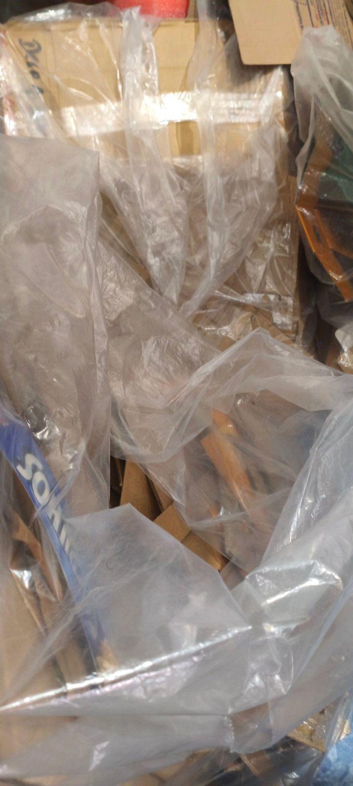
   <em>Figura 16 — Papelão reciclável recolhido para o projeto. Fonte: autoria própria.</em>

## 2. Estrutura externa

O casemod é dividido em **cabeça (cúpula)**, **torso cilíndrico** e **duas pernas laterais** com pés, além de um terceiro pé central visível nas fotografias.

| Parte | Construção |
| --- | --- |
| **Cabeça** | Estrutura de papelão e tiras de papel cartão (caixa de cereal), revestida com cola branca e amido de milho (Maizena). Acabamento externo com massa corrida e interno com fita crepe. Pintura branca e spray metálico prata. |
| **Torso** | Papel Paraná natural em **parede dupla** (duas camadas sobrepostas) para dar rigidez e sustentar o hardware. Fixação com cola quente e reforço em fita crepe. |
| **Pernas** | Estrutura de papelão colada com cola quente, pintura branca, articuladas ao torso por parafusos com porca. |
| **Detalhes visuais** | Papel laminado azul, E.V.A., plástico acrílico com celofane azul atrás (quadrados luminosos), celofane vermelho (círculo vermelho), fundo de lata de refrigerante pintado de preto (olho principal) e luvas de PVC (¾) pintadas de prata (projetores simulados). |
| **Acessos** | Porta de acesso traseira no torso para ligar os cabos à placa-mãe, e botão *Power* na frente, sinalizado por LED verde. |

Observação sobre o terceiro pé: ele aparece nas fotografias do casemod, mas o PDF não descreve sua construção.

### Fotografias do resultado externo

<table>
  <tr>
    <td align="center">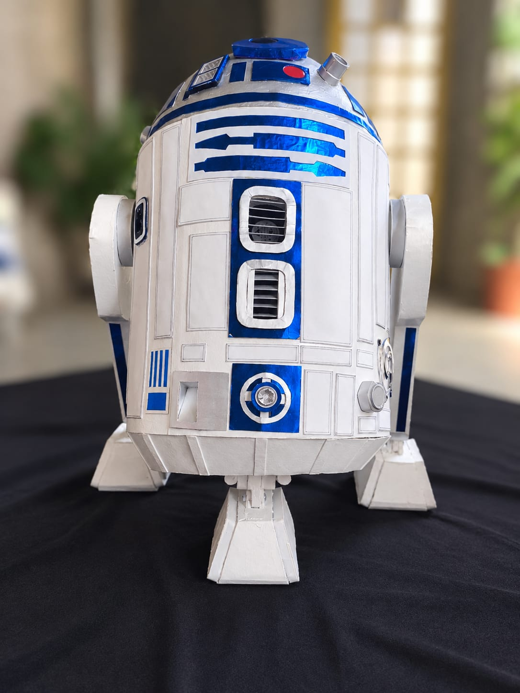 Vista frontal</td>
    <td align="center">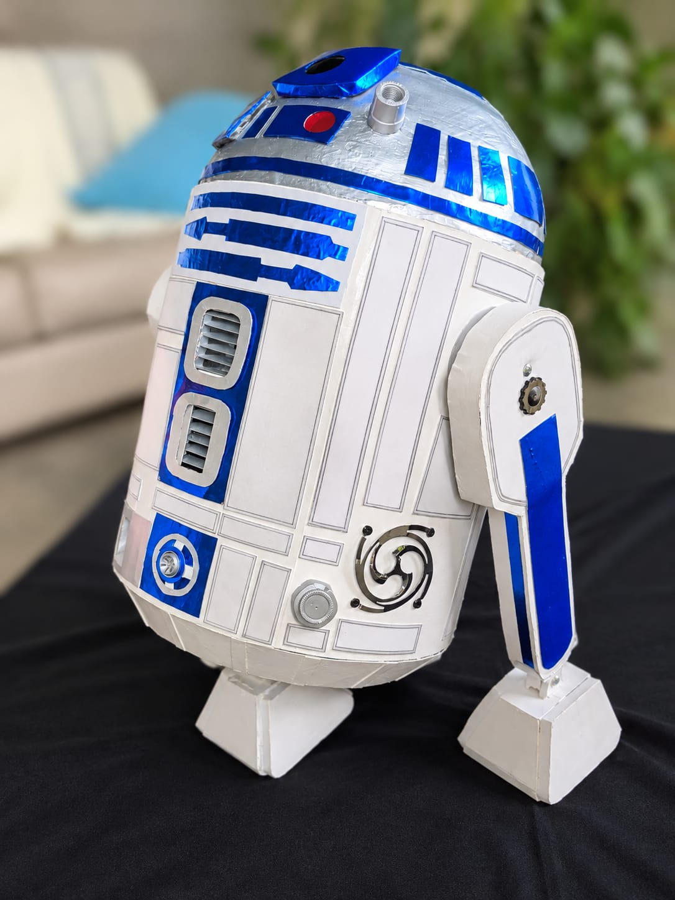 Lateral, com detalhe em espiral no torso</td>
    <td align="center">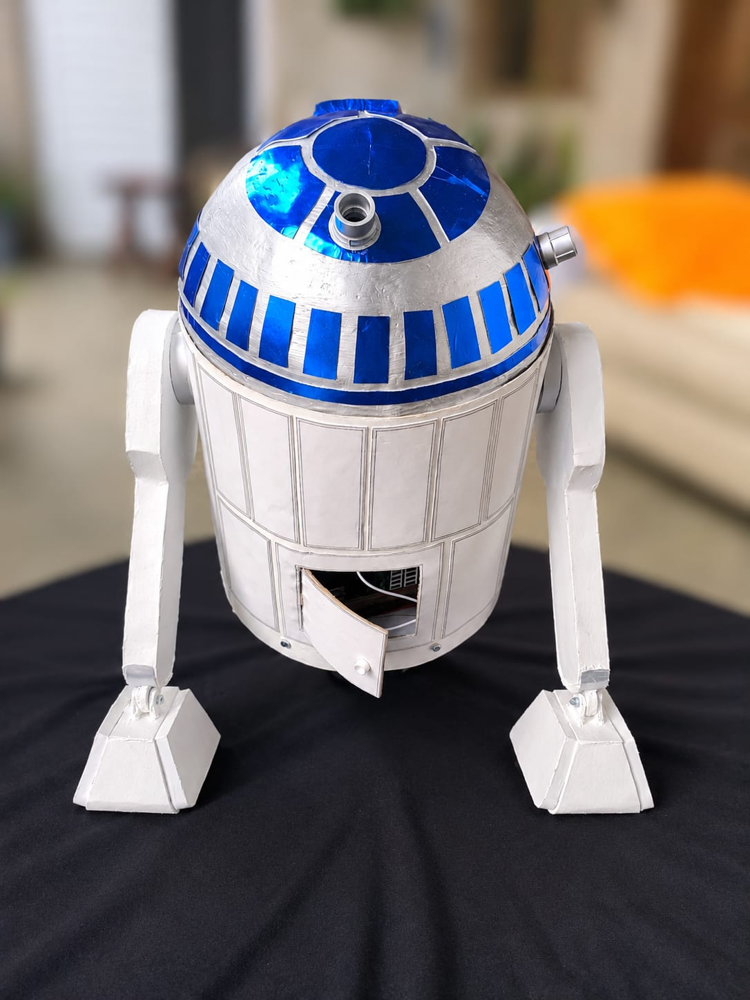 Traseira, porta de acesso aberta</td>
  </tr>
</table>

## 3. Estrutura interna e organização dos componentes

O espaço interno tem **dois compartimentos**:

| Compartimento | Conteúdo |
| --- | --- |
| **Superior (cabeça)** | Iluminação interna e caixas de som, ligadas ao computador por USB (Figura 11). |
| **Inferior (torso)** | Componentes do computador, organizados em três níveis sob medida (Figura 12). |

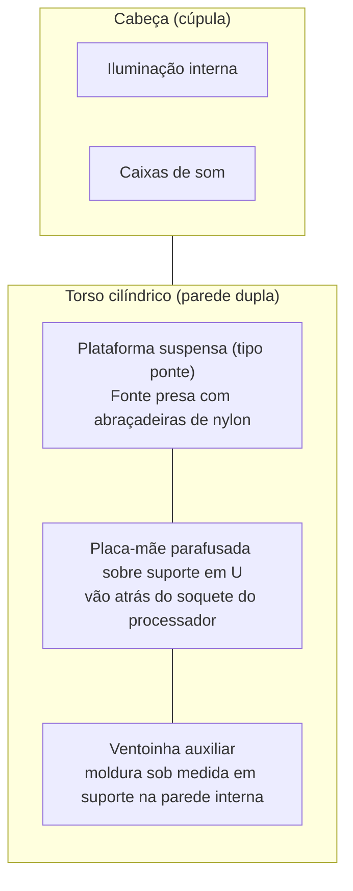

*Esquema conceitual, sem escala, baseado no texto do PDF de Arquitetura.*

### Detalhes dos três níveis do torso

- **Suporte da placa-mãe em "U":** a placa é parafusada sobre uma base de papelão em formato de "U". O objetivo é criar um **vão entre o fundo do torso e a parte traseira do soquete do processador**, abrindo espaço para a dissipação térmica, sem deixar a placa envergar para dentro, pois ela se apoia pelas bordas.
- **Plataforma suspensa da fonte:** uma plataforma de papelão, similar a uma ponte, fica sobre a placa-mãe. A fonte é presa a ela com **abraçadeiras de nylon** ("enforca-gato").
- **Ventilação:** uma **ventoinha auxiliar** é parafusada em uma peça de papelão feita sob medida, que se encaixa em um suporte na parede interna do torso (Figura 13).

<table>
  <tr>
    <td align="center">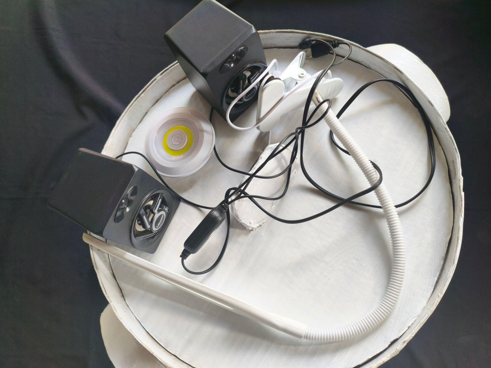 Figura 11 — Espaço interno da cabeça</td>
    <td align="center">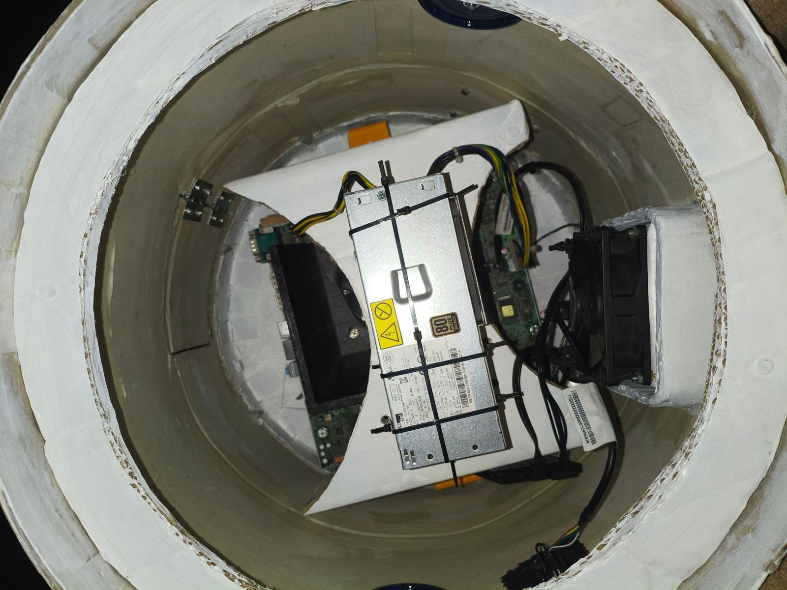 Figura 12 — Espaço interno do torso</td>
  </tr>
  <tr>
    <td align="center">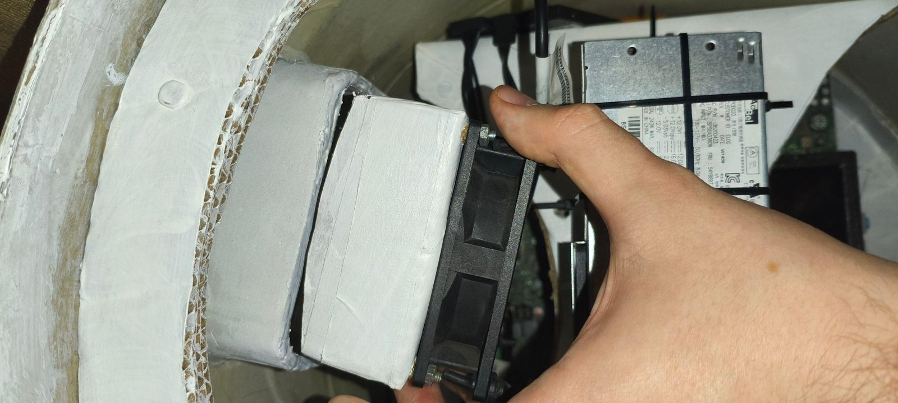 Figura 13 — Encaixe da ventoinha</td>
    <td align="center">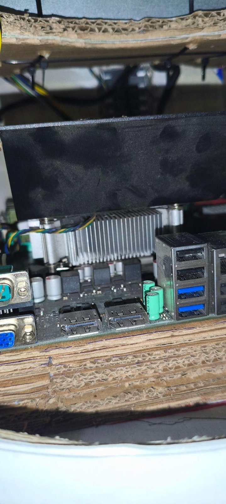 Figura 14 — Suporte da placa-mãe</td>
  </tr>
</table>

O hardware instalado está descrito em [hardware.md](hardware.md).

## 4. Dimensões

Altura total (dos pés ao topo da cúpula): **80 cm**. Circunferência total (contando pernas e torso): **144 cm**.

As medidas por componente foram conferidas contra o croqui manuscrito original (Figura 15).

| Componente | Medidas |
| --- | --- |
| **Cúpula (cabeça)** | 62 cm de arco superior; 120 cm de circunferência da base |
| **Torso cilíndrico** | 41 cm de altura do cilindro principal; 126 cm de circunferência superior; base chanfrada de 6 cm; fundo de 30 cm |
| **Pernas laterais** | 42 cm de comprimento da haste; 14 cm de largura no eixo do ombro; 41 cm de contorno superior |
| **Pés (base)** | Formato trapezoidal: 15 cm de base inferior; 10 cm de topo; 8 cm de altura lateral; 9 cm de profundidade |

  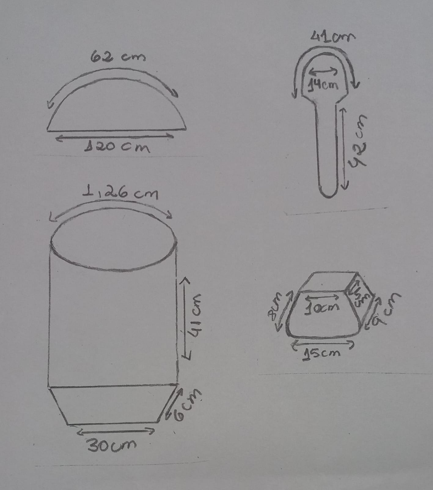
   <em>Figura 15 — Medidas. Fonte: autoria própria.</em>

## 5. Materiais e ferramentas

### Materiais por componente

| Componente | Materiais |
| --- | --- |
| **Cabeça** | Papelão e tiras de papel cartão (caixa de cereal); cola branca com amido de milho; massa corrida; fita crepe; tinta branca e spray metálico prata; papel laminado azul; E.V.A.; celofane azul e vermelho; plástico acrílico; lata de refrigerante; luvas de PVC pintadas em spray prata |
| **Torso** | Papel Paraná natural em parede dupla; cola quente; fita crepe |
| **Pernas** | Papelão; cola quente; tinta branca; parafusos com porca |

### Lista geral

| Categoria | Itens |
| --- | --- |
| **Estruturais e recicláveis** | Papelão ondulado (caixas diversas); papel Paraná natural (80 × 100 cm); papel cartão (caixas de cereal e embalagens Tetra Pak / caixa de leite); conexões e emendas de cano de PVC para água; tampas plásticas diversas (garrafas PET, tubos de creme dental e recicláveis) |
| **Fixação e ferragens** | Cola quente; cola branca (PVA) e amido de milho; fita crepe; abraçadeiras de nylon; parafusos com porca e parafusos soberbos; dobradiças metálicas; rebites de alumínio |
| **Acabamento e pintura** | Massa corrida; tinta branca (base), tinta guache preta e tinta spray metálica prata; folhas de E.V.A. brancas e pretas; papel laminado azul; celofane vermelho e azul; plástico acrílico e lata de alumínio reciclada |
| **Ferramentas** | Compasso de precisão e régua; lápis 6B; estilete e tesoura |

## 6. Etapas de construção

### Etapa 1 — Esqueleto do torso e da cabeça

Foram criados primeiro o esqueleto do torso e o da cabeça.

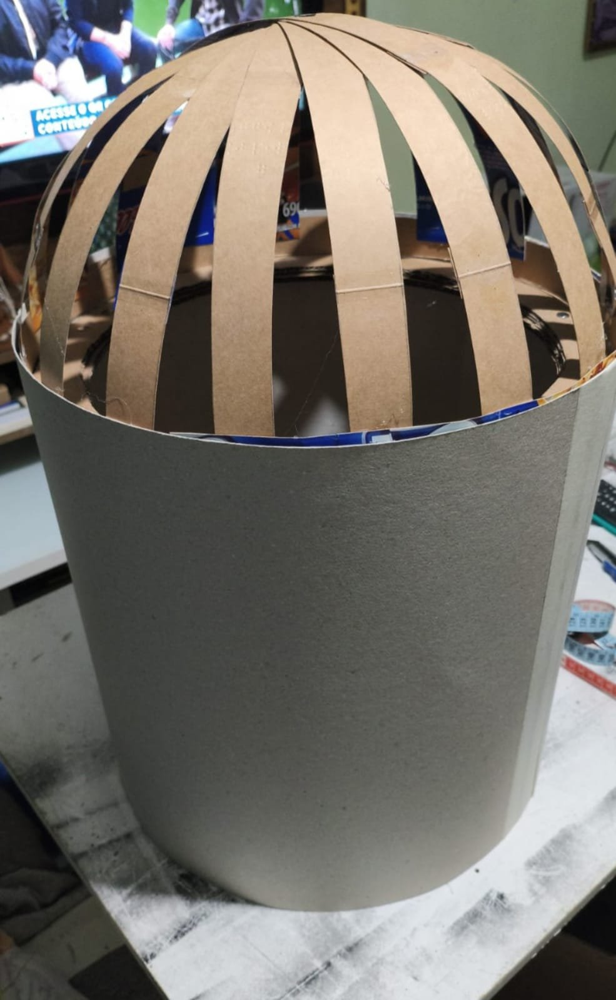 <em>Figura 1 — Esqueleto do torso e da cabeça. Fonte: autoria própria.</em>

### Etapa 2 — Revestimento e reforço da cabeça

O esqueleto da cabeça foi revestido com mais papelão e com uma mistura de maizena e cola. As pernas também foram construídas nesta fase, mas o PDF informa que não há fotografias dessa etapa.

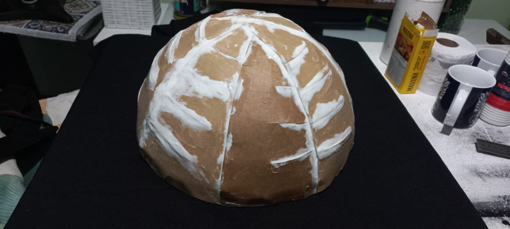 <em>Figura 2 — Cabeça revestida e reforçada. Fonte: autoria própria.</em>

### Etapa 3 — Estudo dos detalhes

Com os componentes principais prontos, foi feito um estudo (esboço) dos detalhes do torso e da cabeça.

<table>
  <tr>
    <td align="center">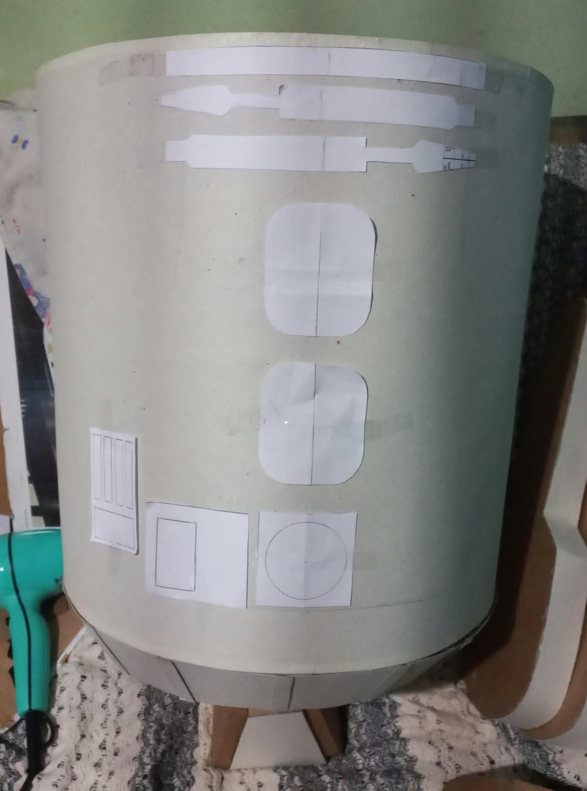 Figura 3 — Esboço dos detalhes do torso</td>
    <td align="center">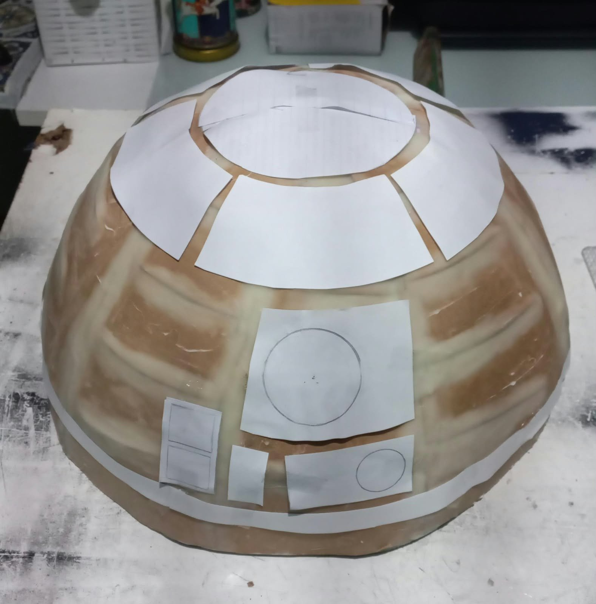 Figura 4 — Esboço dos detalhes da cabeça</td>
  </tr>
</table>

### Etapa 4 — Pintura

Todos os componentes foram pintados de branco, exceto a cabeça.

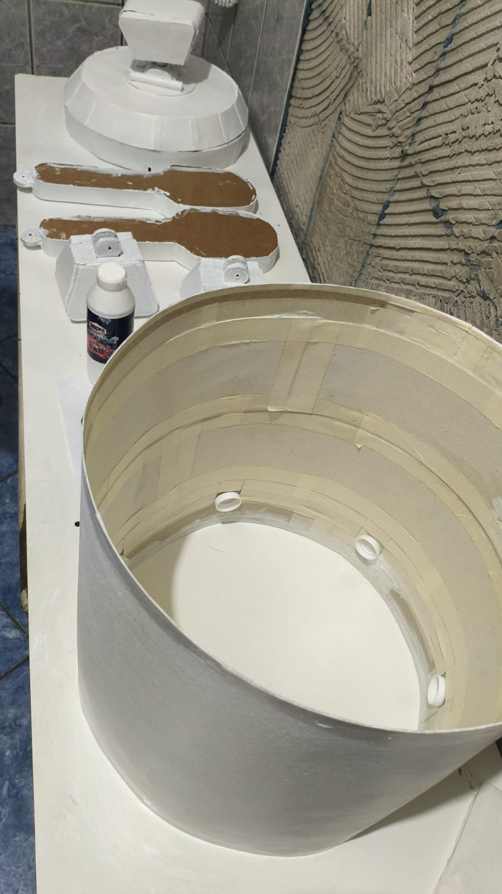 <em>Figura 5 — Pintura. Fonte: autoria própria.</em>

### Etapa 5 — Detalhes e montagem parcial

Foram adicionados os detalhes em papel laminado azul e o casemod foi parcialmente montado (sem a cabeça).

<table>
  <tr>
    <td align="center">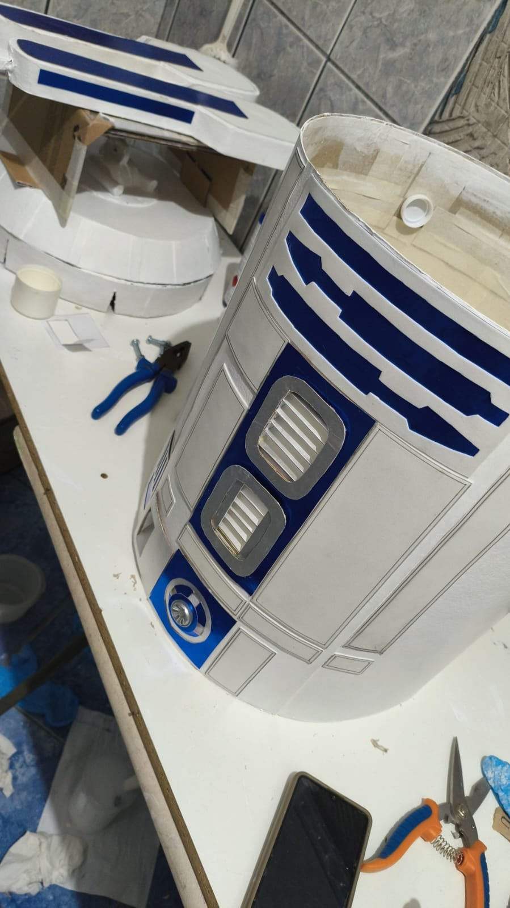 Figura 6 — Os novos detalhes</td>
    <td align="center">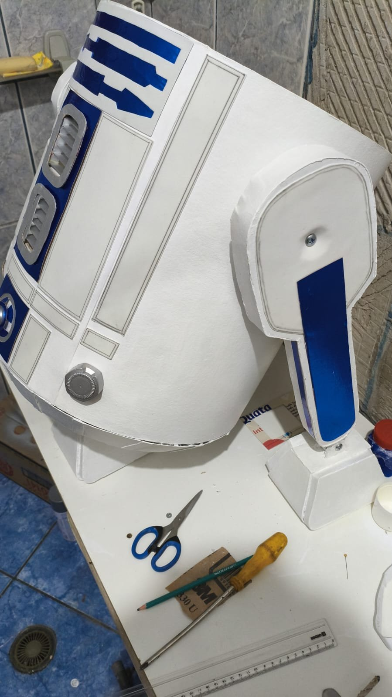 Figura 7 — Casemod sem a cabeça</td>
  </tr>
</table>

### Etapa 6 — Acabamento da cabeça

A cabeça recebeu massa corrida por fora e fita crepe por dentro, e depois pintura branca e spray prata. Em seguida vieram os detalhes ópticos: acrílico com celofane azul atrás (para dar a cor ao ser iluminado), E.V.A., papel laminado azul, luvas de PVC pintadas de prata, fundo de lata pintado de preto (olho) e celofane vermelho (círculo vermelho brilhante).

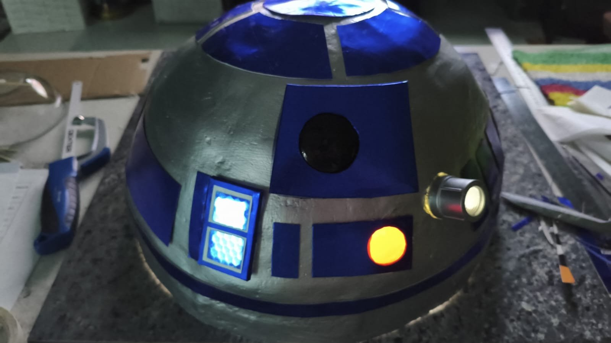 <em>Figura 8 — Cabeça. Fonte: autoria própria.</em>

### Etapa 7 — Acabamento externo e acessos

Na parte externa foram finalizados o **acesso traseiro**, para conectar os cabos à placa-mãe, e, na frente, o local do **botão *Power***, indicado pela luz verde.

<table>
  <tr>
    <td align="center">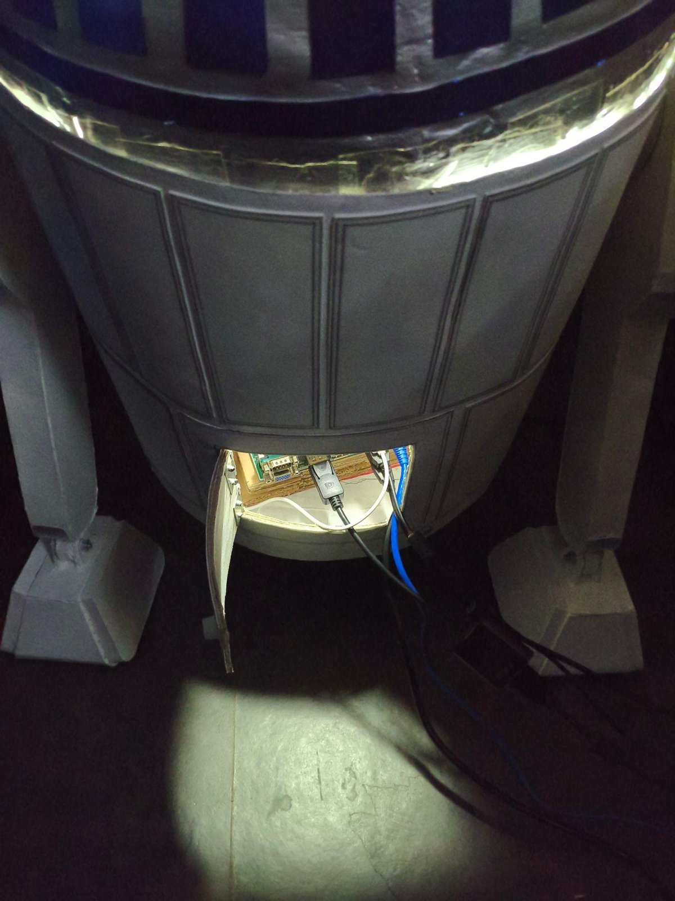 Figura 9 — Acesso traseiro no escuro</td>
    <td align="center">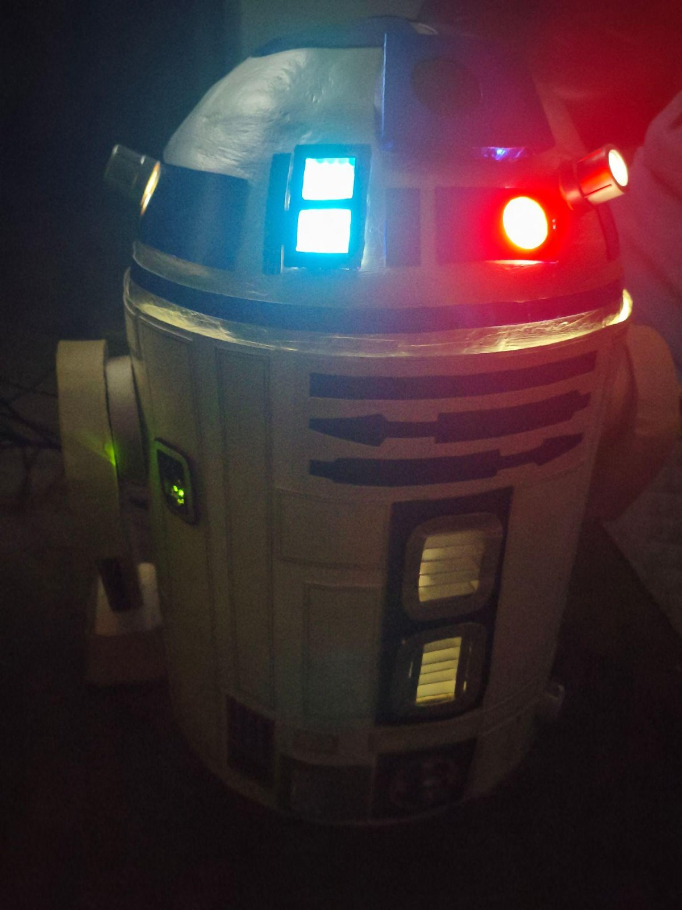 Figura 10 — Visão frontal no escuro</td>
  </tr>
</table>

### Etapa 8 — Montagem interna

Instalação dos componentes nos dois compartimentos, conforme a [seção 3](#3-estrutura-interna-e-organização-dos-componentes) (Figuras 11 a 14).

### Etapa 9 — Medição final

Registro das medidas finais em croqui (Figura 15, [seção 4](#4-dimensões)).

## 7. Desafios e soluções

Problemas de projeto cuja solução o PDF descreve. Alguns são deduzidos da solução descrita, pois o PDF não os apresenta como "desafio"; não há registro de dificuldades adicionais.

| Desafio | Solução adotada |
| --- | --- |
| Papelão disponível pouco flexível para a curvatura cilíndrica | Compra de papel Paraná natural, mais flexível |
| Dar rigidez ao torso para sustentar o hardware | Parede dupla (duas camadas), cola quente e reforço em fita crepe |
| Dissipar o calor do processador sem deixar a placa-mãe envergar | Suporte em "U" que cria um vão atrás do soquete e apoia a placa pelas bordas |
| Acessar as portas da placa-mãe com o computador dentro do casemod | Porta de acesso traseira no torso |
| Isolamento elétrico dos componentes | Uso do papelão como isolante elétrico |
| Fixar a fonte de alimentação dentro do torso | Plataforma suspensa, tipo ponte, com abraçadeiras de nylon |
