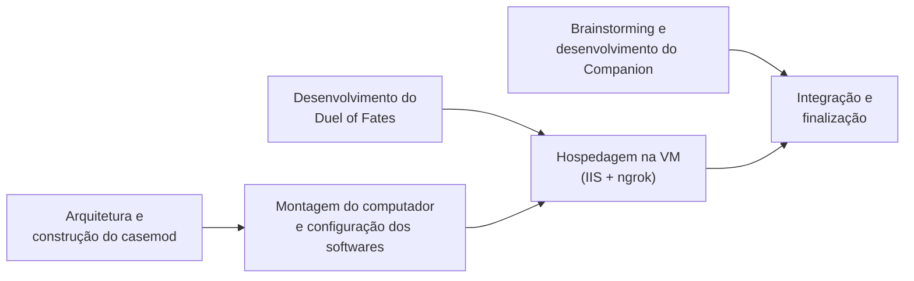

# Desenvolvimento do projeto

> **Responsabilidade editorial principal:** Nicolas Oliveira, com contribuições dos demais integrantes ([equipe.md](equipe.md)).
>
> Este documento conta a **evolução do projeto como um todo**. Os detalhes técnicos estão nos documentos específicos: [arquitetura.md](arquitetura.md), [hardware.md](hardware.md), [software-e-infraestrutura.md](software-e-infraestrutura.md) e [seguranca.md](seguranca.md).

← [Voltar ao índice](README.md)

## Sumário

1. [Origem e concepção](#1-origem-e-concepção)
2. [Principais etapas](#2-principais-etapas)
3. [Cronologia](#3-cronologia)
4. [Construção do casemod](#4-construção-do-casemod)
5. [Montagem e configuração do computador](#5-montagem-e-configuração-do-computador)
6. [Desenvolvimento do Duel of Fates](#6-desenvolvimento-do-duel-of-fates)
7. [Desenvolvimento do R2 Desktop Companion](#7-desenvolvimento-do-r2-desktop-companion)
8. [Integração dos projetos](#8-integração-dos-projetos)
9. [Desafios e soluções](#9-desafios-e-soluções)
10. [Resultado final](#10-resultado-final)

---

## 1. Origem e concepção

O R2-D2 Casemod é um projeto acadêmico do **Centro Universitário UniFECAF (Campus Sede)**, apresentado na **EXPOTEC** de 2026, em Taboão da Serra (SP), sob o título **"R2-D2: Droid Interativo"**. A ideia é um computador personalizado inspirado no droide astromecânico R2-D2, que também serve de plataforma para executar e hospedar projetos de software da equipe.

A concepção do casemod precedeu a construção: a equipe definiu primeiro o tema, o tamanho, o material e a articulação das pernas ([arquitetura.md](arquitetura.md#1-conceito-e-planejamento)).

> **Concepção × implementação.** Este documento separa a data em que cada projeto foi *pensado* da data em que sua *implementação* começou.

## 2. Principais etapas

## 3. Cronologia

Períodos informados pela equipe, com a evidência que os sustenta.

| Atividade | Período | Evidência disponível |
| --- | --- | --- |
| Arquitetura e construção do casemod | Setembro até o início de novembro de 2026 | PDF de Arquitetura (sem datas por etapa) |
| Desenvolvimento do Duel of Fates | Meados de outubro até 15 de novembro de 2026 | Git: primeiro commit em 19/10/2026; tags v1.0.0 (04/11), v1.1.0 e v1.1.1 (06/11). Último commit público em 06/11; o trabalho posterior está só no repositório local, ainda não enviado |
| Montagem do computador e configuração dos softwares | Final de outubro até 14 de novembro de 2026 | Ficha Técnica e PDF Cyber (sem datas) |
| Brainstorming do Companion | Início de novembro de 2026 | Informado pela equipe |
| Desenvolvimento do Companion | Aproximadamente de 8 a 15 de novembro de 2026 | Git: primeiro commit em 09/11/2026; tags de v1.0.1 (09/11) a v1.2.1 (13/11); último commit em 14/11 |
| Integração e finalização | Novembro de 2026 | Informado pela equipe |

Visão por mês (sem dias específicos):

| Atividade | Setembro | Outubro | Início de novembro | Meados de novembro (até 15) |
| --- | :---: | :---: | :---: | :---: |
| Arquitetura e construção do casemod | ■ | ■ | ■ | |
| Duel of Fates | | ■ (a partir de meados) | ■ | ■ |
| Montagem do computador e softwares | | ■ (a partir do final) | ■ | ■ |
| Companion: brainstorming (░) e desenvolvimento (■) | | | ░ | ■ |
| Integração e finalização | | | ■ | ■ |

*Fontes: períodos do briefing do projeto; datas de Git extraídas dos metadados dos repositórios (podem diferir dos dias efetivos de trabalho).*

## 4. Construção do casemod

De setembro ao início de novembro, a estrutura física foi planejada e construída em papelão reciclado e papel Paraná: esqueleto, revestimento, pintura, detalhes, acessos e montagem interna. O resultado tem 80 cm de altura. Etapas, materiais e dimensões estão em [arquitetura.md](arquitetura.md).

## 5. Montagem e configuração do computador

Do final de outubro a 14 de novembro, o hardware foi montado no torso e integrado ao casemod, e foram configurados o Windows 10 Pro, o VirtualBox com as duas VMs, as medidas de segurança e a auditoria com Nmap. O Linux, previsto em dual boot, foi colocado em uma VM por mudança de última hora, para funcionar ao mesmo tempo que o Windows. Detalhes em [hardware.md](hardware.md), [software-e-infraestrutura.md](software-e-infraestrutura.md) e [seguranca.md](seguranca.md).

## 6. Desenvolvimento do Duel of Fates

**Duel of Fates** é um jogo de duelo de lâminas de energia em visão lateral, feito em **Godot 4.7 com GDScript**, com temática de ficção científica. O repositório informa duelos 1 contra 1, 11 personagens, 10 arenas, vários modos (história, duelo, batalhas, operações e combate de naves), português e inglês, teclado e gamepad.

| Marco | Data (Git) |
| --- | --- |
| Primeiro commit (projeto Godot iniciado) | 19/10/2026 |
| Tag v1.0.0 | 04/11/2026 |
| Tags v1.1.0 e v1.1.1 | 06/11/2026 |
| Último commit nas branches públicas | 06/11/2026 |

O desenvolvimento posterior a 06/11/2026 está **apenas no repositório local** e será enviado ao GitHub depois; os marcos acima refletem só o que já foi publicado.

Para a infraestrutura, o ponto relevante é a **exportação Web estática**, publicada no GitHub Pages e hospedada também na VM do casemod ([software-e-infraestrutura.md](software-e-infraestrutura.md#8-publicação-do-duel-of-fates)). O repositório é independente: [nicolasgrotto/duel-of-fates](https://github.com/nicolasgrotto/duel-of-fates).

## 7. Desenvolvimento do R2 Desktop Companion

**R2 Desktop Companion** é um mascote desktop para Windows 10/11 em **Python e PySide6**: um droide com janela transparente, animações e peças articuladas, que funciona **offline** e sem IA, backend ou telemetria. A versão 1.2.1 reúne sete droides, ferramentas (relógio, temporizador, tarefas, notas, diagnóstico), um catálogo de minigames e atualizador manual por GitHub Releases.

| Marco | Data (Git) |
| --- | --- |
| Brainstorming | Início de novembro de 2026 (informado pela equipe) |
| Primeiro commit | 09/11/2026 |
| Tags v1.0.1 a v1.2.1 | 09/11 a 13/11/2026 |
| Último commit | 14/11/2026 |

O repositório é independente: [nicolasgrotto/r2-desktop-companion](https://github.com/nicolasgrotto/r2-desktop-companion).

## 8. Integração dos projetos

Pontos de contato comprovados nos repositórios e nos PDFs:

| De | Para | Natureza |
| --- | --- | --- |
| Companion (menu Ferramentas → Minigames) | Duel of Fates | O Companion abre o endereço do jogo no navegador padrão; não incorpora nem baixa o jogo |
| Computador do casemod (VM Windows Server 2022) | Duel of Fates | Hospedagem em um site do IIS na porta 5000, exposto externamente via ngrok |
| Companion | Casemod | Independente: funciona em qualquer Windows 10/11 x64 e não depende do casemod. Não há scripts de som no casemod; a menção a eles no README do Companion será removida |

## 9. Desafios e soluções

Registrados na documentação do casemod e dos repositórios:

| Área | Desafio | Solução |
| --- | --- | --- |
| Casemod | Dissipar calor sem a placa-mãe envergar | Suporte em "U" que cria vão atrás do soquete ([arquitetura.md](arquitetura.md#7-desafios-e-soluções)) |
| Casemod | Dar rigidez ao torso | Papel Paraná em parede dupla |
| Infraestrutura | Serviços desnecessários expostos na VM | Varredura Nmap e regra de firewall que bloqueia as portas 5357 e 5985 ([seguranca.md](seguranca.md)) |
| Infraestrutura | Com dual boot, só um sistema funciona por vez, o que impediria auditar a rede com o Linux enquanto o Windows está em uso | Mudança de última hora: o Parrot Security OS passou a rodar em VM, ao lado do Windows |
| Duel of Fates | Navegador mantendo versão antiga (cache de até 10 min no GitHub Pages) | Arquivos exportados com o hash do commit no nome |
| Duel of Fates | GitHub Pages não permite os cabeçalhos para threads na Web | Exportação Web sem threads, que dispensa cabeçalhos especiais |
| Duel of Fates | Exportação binária de recursos perdia propriedades | Recursos mantidos em formato texto |
| Companion | Atualizar o executável sem arriscar a instalação | Verificação SHA-256, extração em área temporária, backup completo e recuperação automática |

## 10. Resultado final

- Um **casemod do R2-D2** de 80 cm, construído em papelão, com computador funcional no interior ([arquitetura.md](arquitetura.md), [hardware.md](hardware.md)).
- Um ambiente com **host Windows 10 e duas VMs** (Windows Server 2022 e Parrot Security OS), com hardening documentado ([software-e-infraestrutura.md](software-e-infraestrutura.md), [seguranca.md](seguranca.md)).
- O **Duel of Fates** hospedado com IIS e acesso externo via ngrok.
- O **R2 Desktop Companion** como aplicativo desktop independente.
