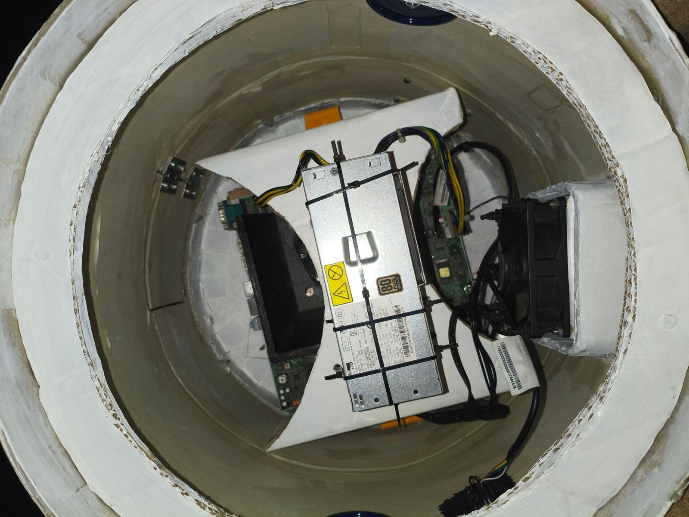
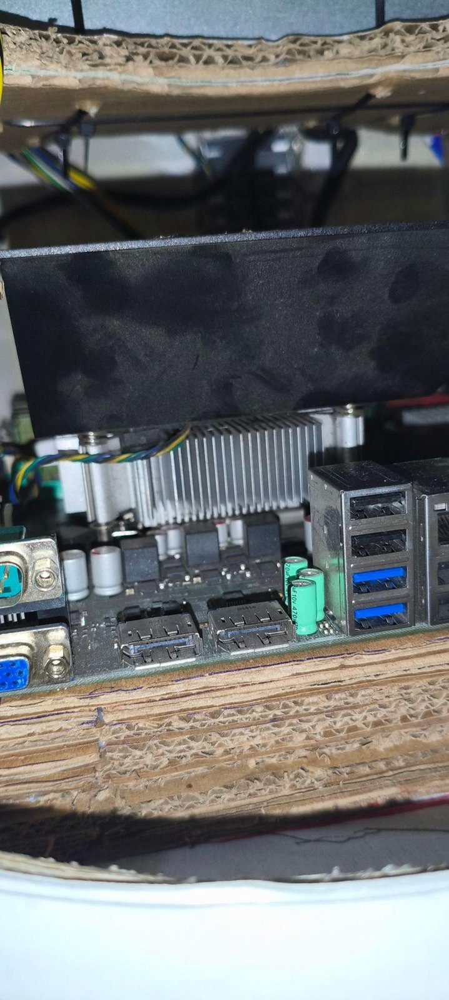
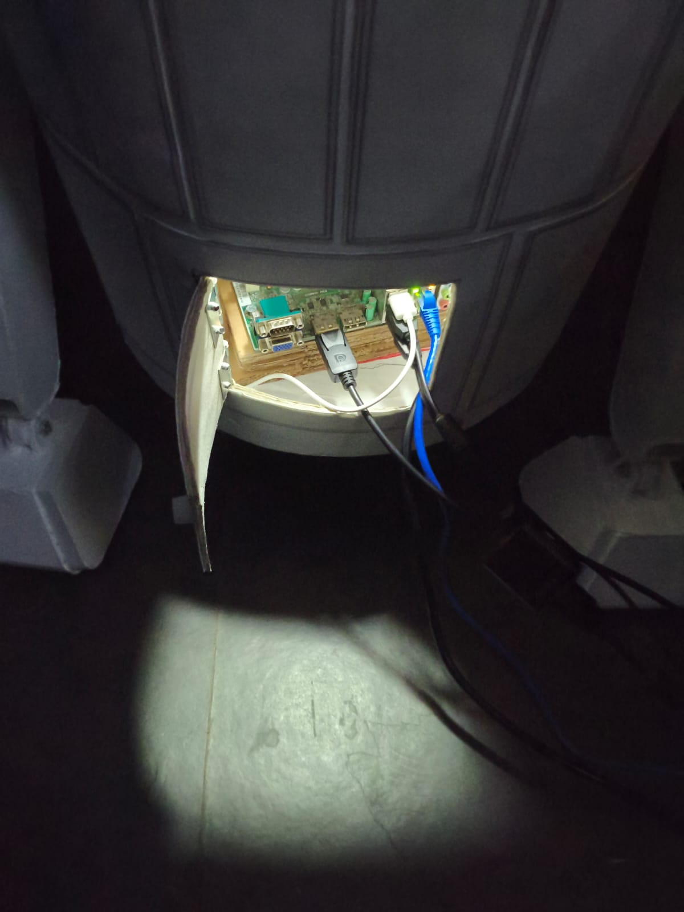

# Hardware

> **Responsáveis principais:** Gabriel Cardoso e Nicolas Egea (montagem dos componentes e integração do hardware ao casemod). Todos os integrantes participaram do projeto; veja [equipe.md](equipe.md).
>
> **Fonte primária:** [Ficha_Tecnica_R2-D2.pdf](pdfs/Ficha_Tecnica_R2-D2.pdf) e [Arquitetura_R2-D2.pdf](pdfs/Arquitetura_R2-D2.pdf).

← [Voltar ao índice](README.md)

## 1. Plataforma

O computador do casemod é baseado em um **Lenovo ThinkCentre M83** (modelo 10AJ0011BP, SKU LENOVO_MT_10AJ), com placa-mãe Lenovo SHARKBAY. Os componentes foram instalados dentro do torso do R2-D2, e não em um gabinete convencional ([arquitetura.md](arquitetura.md)).

## 2. Especificações

Os valores abaixo vêm da Ficha Técnica. Nenhum modelo ou capacidade foi acrescentado além dela.

| Componente | Especificação |
| --- | --- |
| **Sistema / placa-mãe** | Lenovo ThinkCentre M83 (modelo 10AJ0011BP, SKU LENOVO_MT_10AJ); BaseBoard Lenovo SHARKBAY (versão 0B98401 WIN) |
| **BIOS / UEFI** | Lenovo FBKTA5AUS (29/12/2014), SMBIOS 2.8; modo UEFI, Secure Boot desativado |
| **Processador** | Intel® Core™ i7-4770 @ 3,40 GHz, 4 núcleos físicos e 8 processadores lógicos (threads) |
| **Memória RAM** | 16,0 GB DDR3 @ 1333 MHz, formato DIMM, 4 de 4 slots utilizados, dual channel |
| **Gráficos** | Intel® HD Graphics 4600 (integrada ao processador) |
| **Rede (física)** | Intel® Ethernet Connection I217-LM, Gigabit Ethernet |
| **Armazenamento** | SSD Western Digital WD Green 240 GB, SATA III (modelo WDC WDS240G2G0A-00JH30); capacidade utilizável de 223,56 GB |
| **Fonte de alimentação** | AcBel PCB020, 240 W máx. (Lenovo P/N SP50A33609, FRU 54Y8897); certificação 80 PLUS Bronze |
| **Arquitetura** | x64 / amd64 |

O particionamento do SSD e os adaptadores de rede virtuais estão em [software-e-infraestrutura.md](software-e-infraestrutura.md).

## 3. Montagem e integração ao casemod

A organização interna do torso (três níveis sob medida) está detalhada em [arquitetura.md](arquitetura.md#3-estrutura-interna-e-organização-dos-componentes). Resumo da integração:

| Elemento | Como foi integrado |
| --- | --- |
| **Placa-mãe** | Parafusada em um suporte de papelão em formato de "U", que cria um vão atrás do soquete do processador para dissipar calor e apoia a placa pelas bordas |
| **Fonte de alimentação** | Presa com abraçadeiras de nylon a uma plataforma suspensa (tipo ponte) posicionada sobre a placa-mãe |
| **Ventilação** | Ventoinha auxiliar parafusada em uma moldura de papelão sob medida, encaixada em um suporte na parede interna do torso |
| **Conexões externas** | Porta de acesso traseira no torso para ligar os cabos às portas da placa-mãe |
| **Botão *Power*** | Instalado na frente do torso, sinalizado por LED verde |
| **Cabeça** | Abriga a iluminação interna e as caixas de som, ambas ligadas ao computador por **USB** (não há microcontrolador) |

### Registros fotográficos

<table>
  <tr>
    <td align="center"> Espaço interno do torso (Figura 12 do PDF)</td>
    <td align="center"> Suporte da placa-mãe (Figura 14 do PDF)</td>
    <td align="center"> Acesso traseiro com cabos ligados (fotografia)</td>
  </tr>
</table>

Na fotografia do acesso traseiro, é possível observar cabos de vídeo (DisplayPort), de rede (azul) e USB ligados às portas da placa-mãe. A placa também mostra portas VGA e serial.
