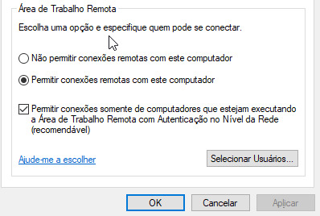

# Segurança cibernética e hardening

> **Responsáveis principais:** Gabriel Cardoso e Nicolas Egea. Todos os integrantes participaram do projeto; veja [equipe.md](equipe.md).
>
> **Documento em PDF:** [Cyber_R2-D2.pdf](pdfs/Cyber_R2-D2.pdf)

← [Voltar ao índice](README.md)

## Sumário

1. [Escopo e tratamento de dados sensíveis](#1-escopo-e-tratamento-de-dados-sensíveis)
2. [Medidas implementadas](#2-medidas-implementadas)
3. [Auditoria de portas com Nmap](#3-auditoria-de-portas-com-nmap)
4. [Hardening do Windows Server 2022](#4-hardening-do-windows-server-2022)
5. [Riscos identificados e mitigação](#5-riscos-identificados-e-mitigação)
6. [Tríade CIA aplicada ao projeto](#6-tríade-cia-aplicada-ao-projeto)

---

## 1. Escopo e tratamento de dados sensíveis

A segurança cobre os três ambientes do projeto: **Windows 10 Pro** (host), **Windows Server 2022** (VM `wswerv`) e **Parrot Security OS 7.4** (VM `Parrot_Cyber`), detalhados em [software-e-infraestrutura.md](software-e-infraestrutura.md).

Esta documentação **não registra** senhas, tokens, chaves, endereços IP reais, o endereço público do túnel ngrok nem o *hostname* do computador. O endereço interno aparece mascarado (`192.168.1.XXX`).

As capturas de tela das duas varreduras Nmap estão no [PDF de Cyber](pdfs/Cyber_R2-D2.pdf) (Figuras 1 e 3).

## 2. Medidas implementadas

| # | Medida | Onde | Descrição |
| --- | --- | --- | --- |
| 1 | **Filtragem de DNS anti-malware** | Os três sistemas | DNS de segurança da Cloudflare (`1.1.1.2` primário e `1.0.0.2` secundário), que bloqueia a resolução de domínios maliciosos e tentativas de *phishing* na camada de rede |
| 2 | **Traffic Policy do ngrok** | Túnel de acesso externo | Política de limitação de taxa (*rate limit*) no túnel reverso HTTPS (TLS), que restringe as requisições por IP antes de chegarem a `localhost:5000` (seção 2.1) |
| 3 | **Proteção de endpoint** | Windows 10 e Windows Server 2022 | Windows Defender com monitoramento em tempo real |
| 4 | **Isolamento por *sandbox*** | Parrot Security OS | Mecanismos nativos de confinamento de aplicações via **Firejail** e recursos de proteção de rede |
| 5 | **VPN** | Windows 10 (host) | ProtonVPN em interface de túnel virtual dedicada, para confidencialidade e integridade do tráfego externo |
| 6 | **Gerenciamento de atualizações** | Os três sistemas | Atualização integral de pacotes e correções, para mitigar vulnerabilidades conhecidas (CVEs) |
| 7 | **Política de credenciais fortes** | Contas administrativas dos três sistemas | Senhas robustas com maiúsculas, minúsculas, números e símbolos, contra ataques de força bruta e de dicionário |
| 8 | **Auditoria de portas com Nmap** | VM `Parrot_Cyber` contra a VM `wswerv` | Varredura de reconhecimento e detecção de versões (seção 3) |
| 9 | **Regra de firewall de bloqueio** | VM `wswerv` | Bloqueio de entrada das portas 5357 e 5985 (seção 4) |
| 10 | **RDP habilitado de forma controlada** | VM `wswerv` | Acesso remoto administrativo ativado, com regra de entrada específica no Windows Defender Firewall, restrito à rede local e protegido por Autenticação no Nível da Rede (NLA) (seção 4) |
| 11 | **Isolamento da aplicação em *loopback*** | VM `wswerv` | A aplicação em `localhost:5000` não é acessível diretamente pela rede local |

O host usa **UEFI com Secure Boot desativado**.

### 2.1 Regra de limitação de taxa no ngrok

O túnel reverso em HTTPS (TLS) do ngrok expõe a aplicação web externamente. A Traffic Policy aplicada usa a regra `Protecao_Anti_DDoS_R2D2`, do tipo `rate-limit`, com algoritmo de janela deslizante (*sliding window*) e contagem por endereço IP do cliente (`conn.client_ip`). Cada IP pode fazer no máximo **60 requisições a cada 60 segundos** antes de a requisição chegar ao serviço local em `localhost:5000`.

```yaml
on_http_request:
  - actions:
      - type: rate-limit
        config:
          name: "Protecao_Anti_DDoS_R2D2"
          algorithm: sliding_window
          capacity: 60
          rate: 60s
          bucket_key:
            - conn.client_ip
```

## 3. Auditoria de portas com Nmap

A partir da VM `Parrot_Cyber` foi executada uma varredura de reconhecimento e detecção de versões contra o endereço interno do Windows Server 2022, na rede em modo Bridge:

```bash
sudo nmap -sV -Pn 192.168.1.XXX
```

**1.ª varredura (diagnóstico inicial, 14/11/2026, 997 portas filtradas):**

| Porta | Estado | Serviço | Observação |
| --- | --- | --- | --- |
| 80/tcp | aberta | Microsoft IIS httpd 10.0 | Servidor web ativo, operando em conjunto com a aplicação local em `localhost:5000` |
| 5357/tcp | aberta | Microsoft HTTPAPI httpd 2.0 | Serviço de descoberta de dispositivos na rede local (WSDAPI), rotulado pela assinatura padrão do Nmap como SSDP/UPnP |
| 5985/tcp | aberta | Microsoft HTTPAPI httpd 2.0 | WinRM, gerenciamento remoto do Windows via HTTP sem criptografia |
| 3389/tcp | **ausente** | n/d | Permitiu concluir que o RDP, requisito do projeto, estava desativado |

Conclusões: a porta interna da aplicação (`localhost:5000`) permaneceu isolada (protegida em *loopback*) e o RDP precisava ser habilitado. A porta 5000 é a do site do Duel of Fates no IIS, exposta externamente pelo ngrok.

**2.ª varredura (validação pós-hardening, 14/11/2026, 998 portas filtradas):**

| Porta | Estado | Serviço | Observação |
| --- | --- | --- | --- |
| 80/tcp | aberta | Microsoft IIS httpd 10.0 | Ativo para o serviço web do projeto |
| 3389/tcp | aberta | Microsoft Terminal Services (`ms-wbt-server`) | Ativo e restrito à gerência na rede local privada, com autenticação NLA |
| 5357/tcp e 5985/tcp | filtradas | n/d | Bloqueadas pelo Windows Defender Firewall e incluídas nas 998 portas TCP filtradas (sem resposta) |

## 4. Hardening do Windows Server 2022

Com base no diagnóstico do Nmap, foram executadas duas ações corretivas:

1. **Ativação controlada do RDP (porta 3389/tcp):** habilitação do acesso remoto administrativo exigido pelos requisitos do projeto e liberação da regra de entrada correspondente no Windows Defender Firewall. Como o túnel externo do ngrok expõe exclusivamente a aplicação web, o RDP fica acessível apenas dentro da rede local privada (LAN) e protegido pela exigência de **Autenticação no Nível da Rede (NLA)**.

<p align="center">
  <br>
  <sub>Figura 1 — NLA ativada</sub>
</p>
2. **Redução da superfície de ataque:** regra restritiva de entrada `Hardening_R2D2_Bloqueio_WinRM`, que bloqueia o tráfego TCP nas portas desnecessárias 5357 e 5985:

```cmd
netsh advfirewall firewall add rule name="Hardening_R2D2_Bloqueio_WinRM" dir=in action=block protocol=TCP localport=5985,5357
```

**Resultado:** a aplicação principal opera isolada em `localhost:5000`, protegida externamente pela política `Protecao_Anti_DDoS_R2D2` no ngrok, e o servidor expõe na rede local apenas os serviços estritamente necessários: **80/tcp** (IIS) e **3389/tcp** (RDP). As demais portas ficam filtradas, como a 2.ª varredura confirmou (seção 3).

## 5. Riscos identificados e mitigação

Riscos identificados e mitigações aplicadas:

| Risco | Origem | Mitigação aplicada | Situação |
| --- | --- | --- | --- |
| WinRM (5985) exposto, via HTTP sem criptografia | Varredura Nmap | Regra de firewall de bloqueio | Mitigado; confirmado pela 2.ª varredura |
| Serviço de descoberta de dispositivos (5357) exposto | Varredura Nmap | Regra de firewall de bloqueio | Mitigado; confirmado pela 2.ª varredura |
| Aplicação web acessível diretamente na rede local | Arquitetura (`localhost:5000`) | Aplicação mantida em *loopback* | Mitigado; confirmado pela varredura |
| Exposição externa da aplicação e excesso de requisições | Uso do ngrok | Túnel HTTPS/TLS com limite de 60 requisições a cada 60 segundos por IP | Mitigado |
| Administração remota (RDP) exposta | Habilitação do RDP | Acesso só pela LAN, com NLA e regra de firewall específica | Mitigado; confirmado pela 2.ª varredura |
| Resolução de domínios maliciosos e *phishing* | Navegação e atualizações | DNS Cloudflare `1.1.1.2` / `1.0.0.2` | Mitigado |
| Vulnerabilidades conhecidas (CVEs) | Pacotes desatualizados | Atualização integral dos três sistemas | Mitigado no momento da atualização |
| Ataques de força bruta e de dicionário | Contas administrativas | Senhas fortes e padronizadas | Mitigado |
| Tráfego externo do host exposto | Rede do host | ProtonVPN em interface dedicada | Mitigado |

## 6. Tríade CIA aplicada ao projeto

A segurança da informação se apoia em três pilares, conhecidos como tríade CIA: **confidencialidade**, **integridade** e **disponibilidade**. No R2-D2 Casemod, as medidas de segurança foram pensadas para cobrir os três, já que o computador hospeda uma aplicação acessível pela internet.

**Confidencialidade: somente quem deve ter acesso, tem.** No projeto, isso significa que só as pessoas autorizadas podem administrar o servidor, e que o tráfego não fica exposto durante o acesso externo.

- O acesso remoto ao Windows Server (RDP) fica restrito à rede local e exige autenticação em nível de rede (NLA).
- O acesso externo ao jogo passa por um túnel ngrok com criptografia HTTPS/TLS.
- A porta 5000, onde o site roda no IIS, aceita conexões apenas da própria máquina (`localhost`).
- Uma regra no firewall bloqueia as portas 5357 e 5985, ligadas à descoberta de dispositivos e ao gerenciamento remoto do Windows.
- As contas administrativas usam senhas fortes, e o host usa VPN (ProtonVPN) para proteger o tráfego externo.

**Integridade: a informação não é alterada de forma indevida.** Aqui o objetivo é impedir que o servidor, o sistema e a aplicação sejam modificados por quem não deveria.

- O Windows Defender e o DNS com filtro de malware da Cloudflare (`1.1.1.2` e `1.0.0.2`) ajudam a barrar arquivos e domínios maliciosos.
- Os sistemas são mantidos atualizados, o que corrige falhas conhecidas.
- A varredura com Nmap identificou serviços desnecessários, que foram bloqueados. Menos serviços abertos significa menos pontos de ataque.
- O Firejail, no Parrot, executa aplicações em ambiente isolado (*sandbox*).
- O servidor roda em uma máquina virtual separada do sistema principal, o que limita o impacto de uma eventual alteração indevida.

**Disponibilidade: sistemas e dados acessíveis quando necessário.** Para uma exposição como a do EXPOTEC, o jogo precisa continuar no ar mesmo se alguém tentar sobrecarregar o servidor.

- A Traffic Policy do ngrok limita cada IP a 60 requisições a cada 60 segundos, o que reduz o risco de sobrecarga e de ataques de negação de serviço.
- Só as portas 80 (IIS) e 3389 (RDP) permanecem abertas, o que foi confirmado pela segunda varredura do Nmap.
- A virtualização permite que o Windows Server e o Parrot funcionem ao mesmo tempo, então os testes de segurança são feitos sem tirar o servidor do ar.

**Resumo**

| Pilar | Principais medidas do projeto |
| --- | --- |
| Confidencialidade | RDP restrito à rede local com NLA, HTTPS/TLS no ngrok, `localhost` na porta 5000, firewall bloqueando as portas 5357 e 5985, senhas fortes e VPN |
| Integridade | Windows Defender, DNS anti-malware, atualizações, redução de serviços expostos, Firejail e isolamento em máquina virtual |
| Disponibilidade | Limite de requisições por IP no ngrok, apenas as portas 80 e 3389 abertas e máquinas virtuais em execução simultânea |

Algumas medidas contribuem para mais de um pilar. O firewall, por exemplo, protege a confidencialidade e também reduz a superfície de ataque.
