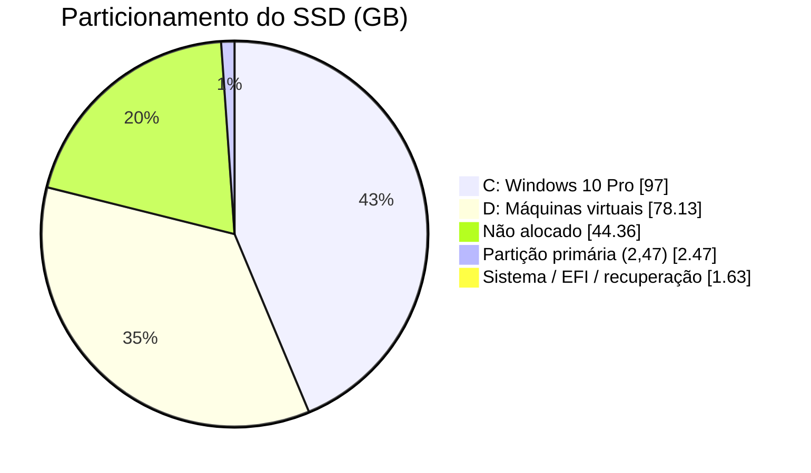
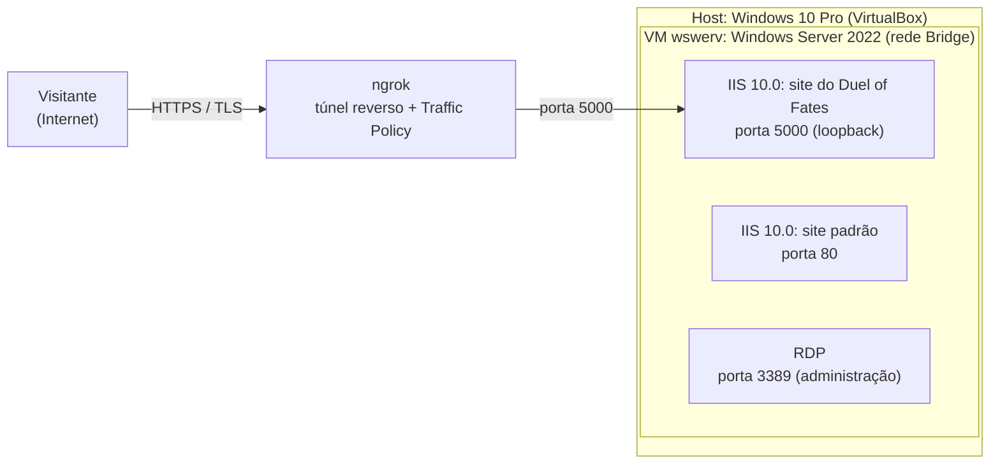
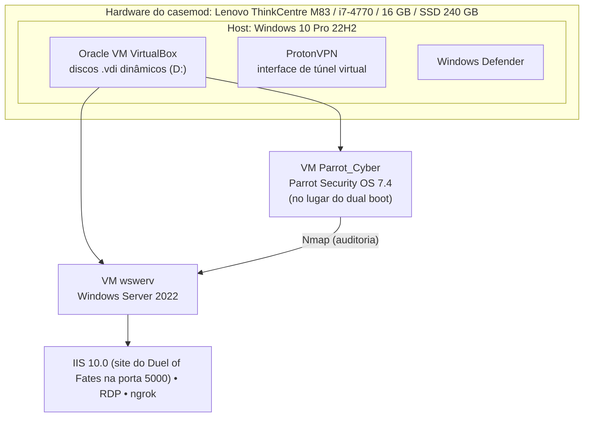

# Software e infraestrutura

> **Responsáveis principais:**
> - Sistemas operacionais e particionamento (Parte I): Gabriel Cardoso e Nicolas Egea.
> - Máquinas virtuais e Windows Server 2022: Heitor Resende.
> - Hospedagem do Duel of Fates no IIS e acesso externo via ngrok: Nicolas Oliveira.
>
> Todos os integrantes participaram do projeto; veja [equipe.md](equipe.md).
>
> **Documentos em PDF:** [Ficha_Tecnica_R2-D2.pdf](pdfs/Ficha_Tecnica_R2-D2.pdf) e [Cyber_R2-D2.pdf](pdfs/Cyber_R2-D2.pdf). O Duel of Fates e o Companion têm repositórios próprios (links na [seção 6](#6-projetos-hospedados-ou-executados-no-computador)).

← [Voltar ao índice](README.md)

## Sumário

**Parte I — Sistemas operacionais e configuração**
1. [Visão geral dos ambientes](#1-visão-geral-dos-ambientes)
2. [Sistema operacional base (host)](#2-sistema-operacional-base-host)
3. [Particionamento e organização dos discos](#3-particionamento-e-organização-dos-discos)
4. [Dual boot](#4-dual-boot)

**Parte II — Virtualização e hospedagem**

5. [Virtualização com VirtualBox](#5-virtualização-com-virtualbox)
6. [Projetos hospedados ou executados no computador](#6-projetos-hospedados-ou-executados-no-computador)
7. [Windows Server 2022 e IIS](#7-windows-server-2022-e-iis)
8. [Publicação do Duel of Fates](#8-publicação-do-duel-of-fates)
9. [ngrok e fluxo de acesso externo](#9-ngrok-e-fluxo-de-acesso-externo)
10. [Relação entre host, máquinas virtuais e serviços](#10-relação-entre-host-máquinas-virtuais-e-serviços)

---

# Parte I — Sistemas operacionais e configuração

## 1. Visão geral dos ambientes

O projeto opera sobre três ambientes integrados:

| Ambiente | Sistema | Função |
| --- | --- | --- |
| **Host** | Microsoft Windows 10 Pro (64 bits), instalado diretamente no hardware do casemod | Sistema principal; executa o VirtualBox; usa ProtonVPN |
| **VM `wswerv`** | Microsoft Windows Server 2022 (64 bits) | Hospeda a aplicação web do projeto (IIS 10.0); administração remota por RDP |
| **VM `Parrot_Cyber`** | Parrot Security OS 7.4 (amd64), sistema de arquivos Btrfs | Estação dedicada de segurança cibernética, pentest e auditoria de vulnerabilidades; roda em VM, ao mesmo tempo que o Windows, no lugar do dual boot planejado |

## 2. Sistema operacional base (host)

| Item | Valor |
| --- | --- |
| Sistema | Microsoft Windows 10 Pro (64 bits) |
| Versão | 10.0.19045, compilação 19045 (22H2) |
| HAL | 10.0.19041.6456 |
| Modo de inicialização | UEFI, com Secure Boot desativado |
| Arquitetura | x64 / amd64 |

Detalhes de hardware em [hardware.md](hardware.md). A configuração de segurança do host (Windows Defender, DNS, VPN) está em [seguranca.md](seguranca.md).

## 3. Particionamento e organização dos discos

O armazenamento físico é um SSD de 240 GB (capacidade utilizável de 223,56 GB). Esquema registrado na Ficha Técnica:

| Partição / espaço | Tamanho | Sistema de arquivos | Uso |
| --- | --- | --- | --- |
| **C:** | 97,00 GB | NTFS | Windows 10 Pro (sistema base / host) |
| **D:** | 78,13 GB | NTFS | Partição de virtualização (máquinas virtuais) |
| Espaço secundário | 44,36 GB | — | Não alocado |
| Espaço secundário | 2,47 GB | — | Partição primária |
| Sistema / EFI / recuperação | 100 MB + 556 MB + 977 MB | — | Partições de sistema |

## 4. Dual boot

O planejamento inicial previa **dual boot**: o Linux seria instalado no mesmo computador, ao lado do Windows. Por uma **mudança de última hora**, o Linux (Parrot Security OS) passou a rodar em uma **máquina virtual**, e o dual boot **não foi implementado**.

**Motivo da mudança:** com dual boot, só um sistema funciona por vez. A estação de segurança precisa auditar a rede e os sistemas Windows *enquanto* o Windows está em uso, e com a VM o Linux e o Windows rodam ao mesmo tempo.

Por isso a Ficha Técnica lista um único sistema instalado diretamente no hardware (Windows 10 Pro), com o Windows Server 2022 e o Parrot em VMs ([seção 5](#5-virtualização-com-virtualbox)).

---

# Parte II — Virtualização e hospedagem

## 5. Virtualização com VirtualBox

O hipervisor é o **Oracle VM VirtualBox**, que aloja as máquinas virtuais do projeto em **discos dinâmicos `.vdi`**. As máquinas ficam na partição de virtualização (D:).

| Item | Valor |
| --- | --- |
| Hipervisor | Oracle VM VirtualBox, no host Windows 10 |
| Formato de disco | `.vdi` dinâmico |
| Rede das VMs | Adaptador virtual Oracle VirtualBox (Intel PRO/1000 MT Desktop) em **modo Bridge** |
| VMs | `wswerv` (Windows Server 2022) e `Parrot_Cyber` (Parrot Security OS 7.4) |

No modo Bridge, as VMs aparecem na rede local com endereços próprios. Foi assim que a VM Parrot_Cyber pôde varrer o Windows Server com o Nmap ([seguranca.md](seguranca.md)).

O Parrot roda em VM, e não em dual boot, para funcionar ao mesmo tempo que o Windows ([seção 4](#4-dual-boot)). A configuração das máquinas virtuais e do Windows Server 2022 foi feita por **Heitor Resende**.

## 6. Projetos hospedados ou executados no computador

O computador do casemod funciona como plataforma para executar e hospedar os projetos de software da equipe. Cada projeto tem repositório próprio, e a documentação interna fica lá. Aqui registramos apenas o que importa para a infraestrutura.

| Projeto | Repositório | Tecnologia (conforme o repositório) | Relação com o computador do casemod |
| --- | --- | --- | --- |
| **Duel of Fates** | [nicolasgrotto/duel-of-fates](https://github.com/nicolasgrotto/duel-of-fates) | Godot 4.7 (GDScript); exportação Web estática | Hospedado na VM Windows Server 2022, em um site do IIS na porta 5000, com acesso externo via ngrok |
| **R2 Desktop Companion** | [nicolasgrotto/r2-desktop-companion](https://github.com/nicolasgrotto/r2-desktop-companion) | Python 3.12+ e PySide6; aplicativo desktop para Windows 10/11 x64 | Compatível com o Windows 10 22H2 do host |

O Companion é **independente do casemod**: funciona offline e só acessa a rede quando o usuário pede uma atualização manual. O casemod não usa scripts de som: a iluminação e as caixas são ligadas por USB, sem microcontrolador.

## 7. Windows Server 2022 e IIS

A VM `wswerv` roda o **Microsoft Windows Server 2022** e é responsável por:

- hospedar a aplicação web do projeto via **Microsoft IIS 10.0**;
- expor o conteúdo externamente por **túnel reverso ngrok (HTTPS)**;
- permitir administração remota por **RDP (porta 3389)**.

A hospedagem do jogo no IIS e o acesso externo via ngrok foram feitos por **Nicolas Oliveira**.

A porta **5000** é a porta alocada no IIS para o site do **Duel of Fates**, e é ela que o **ngrok expõe**. Ela permanece restrita à interface de loopback (`localhost:5000`), sem acesso direto pela rede local. A porta **80/tcp** responde como Microsoft IIS httpd 10.0 e serve apenas o site padrão do IIS, sem conteúdo do projeto.

Portas de rede da VM, depois do hardening:

| Porta | Serviço | Situação |
| --- | --- | --- |
| 80/tcp | IIS (site padrão, sem conteúdo do projeto) | Exposta na rede local |
| 3389/tcp | RDP (administração remota) | Habilitada e liberada no Windows Defender Firewall; acessível só na rede local, com NLA |
| 5000/tcp | Site do IIS com o Duel of Fates (destino do ngrok) | Somente em loopback (`localhost`) |
| 5357/tcp e 5985/tcp | HTTPAPI (descoberta de dispositivos e WinRM) | Bloqueadas por regra de firewall |

Detalhes da regra e das varreduras em [seguranca.md](seguranca.md).

## 8. Publicação do Duel of Fates

O Duel of Fates foi desenvolvido em repositório independente e depois hospedado na VM. Características da exportação Web:

| Característica da exportação Web | Valor |
| --- | --- |
| Engine | Godot 4.7 (o fluxo de CI usa 4.7.2) |
| Tipo de saída | Site estático: `index.html` mais arquivos `.js`, `.wasm` e `.pck` com o hash do commit no nome |
| Threads | Desativadas (`thread_support=false`); a build **não precisa de cabeçalhos HTTP especiais** |
| Tamanho aproximado | `index.wasm` ~39 MB (motor) e `index.pck` ~2,7 MB (jogo) |
| Publicação oficial do projeto | GitHub Pages, por GitHub Actions; as releases também trazem o ZIP Web, que "precisa de um servidor HTTP local para abrir" |

Esses dados mostram que a build é compatível com um servidor web estático, como o IIS. O repositório do jogo **não contém** configuração de IIS, ngrok nem Windows Server; essa parte da hospedagem foi feita na infraestrutura do casemod e está descrita nesta documentação.

- O desenvolvimento do jogo posterior a 06/11/2026 está **apenas no repositório local**; as alterações serão enviadas ao GitHub depois.

## 9. ngrok e fluxo de acesso externo

O **ngrok** é usado para disponibilizar a aplicação para fora da rede local. Ele cria um **túnel reverso** com acesso por **HTTPS (TLS)**; por ser reverso (a conexão parte da máquina de dentro para fora), esse tipo de túnel dispensa, em geral, redirecionamento de portas no roteador. Uma *Traffic Policy* no túnel limita o tráfego a 60 requisições a cada 60 segundos por IP do cliente antes de ele chegar ao serviço local em `localhost:5000` ([seguranca.md](seguranca.md#21-regra-de-limitação-de-taxa-no-ngrok)).

*O túnel ngrok expõe a porta 5000, a do site do Duel of Fates no IIS.*

## 10. Relação entre host, máquinas virtuais e serviços

| Relação | Descrição |
| --- | --- |
| Host → VMs | O host executa o VirtualBox, que mantém as duas VMs em discos `.vdi` na partição D: |
| Rede | VMs em modo Bridge na rede local; o host tem ainda uma interface virtual do ProtonVPN |
| VM `wswerv` → Internet | Acesso externo apenas via túnel ngrok (HTTPS) |
| VM `Parrot_Cyber` → VM `wswerv` | Auditoria de portas e superfície de ataque com Nmap |
| DNS | Cloudflare `1.1.1.2` (primário) e `1.0.0.2` (secundário) nos três sistemas (veja [seguranca.md](seguranca.md)) |
